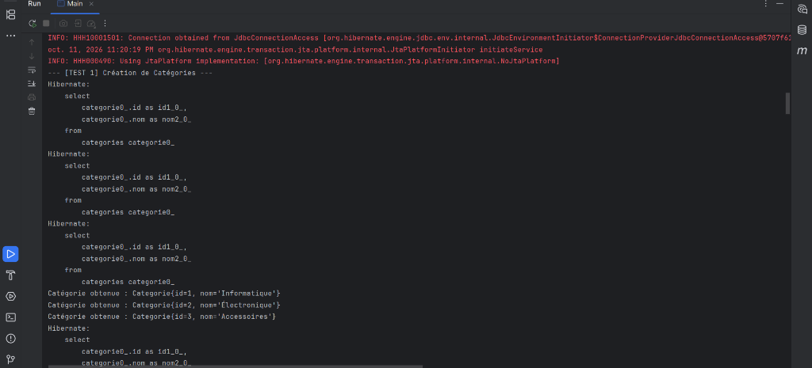

# 🛒 Gestion Commerciale – Révision JEE / JPA / Hibernate

Ce projet est une application complète de révision des technologies **JEE**, **JPA** et **Hibernate (5.6+)** avec une base de données **MySQL / MariaDB**. Il met en œuvre les bonnes pratiques de conception logicielle (architecture en couches, généricité, Criteria API, patterns DAO et Service, gestion fine des transactions et stratégies d'héritage).

---

## 📸 Capture d'écran de l'exécution

Voici le résultat de l'exécution complète des 10 scénarios de test dans `Main.java` :



---

## 🚀 Fonctionnalités & Concepts Abordés

### 1. Configuration & Persistance Hybride
- **Hibernate Natif** : Configuration via [`src/main/resources/hibernate.cfg.xml`](./src/main/resources/hibernate.cfg.xml) et classe utilitaire [`HibernateUtil`](./src/main/java/org/example/util/HibernateUtil.java).
- **JPA Standard** : Unité de persistance `defaultPU` définie dans [`src/main/resources/META-INF/persistence.xml`](./src/main/resources/META-INF/persistence.xml).
- Configuration du dialecte MySQL 8 / MariaDB, du mode `hbm2ddl.auto=update` et du `hibernate.jdbc.batch_size=20`.

### 2. Modèle de Données & Relations ORM
- **Entité `Categorie`** : Classification des produits avec nom unique (`@Column(unique = true)`).
- **Entité `Produit`** : Attributs métier, association `@ManyToOne(fetch = FetchType.LAZY)` vers `Categorie` et relation inverse `@OneToMany` bidirectionnelle avec méthodes d'assistance (`addProduit`, `removeProduit`).
- **Héritage JPA (Stratégie `JOINED`)** :
  - Classe abstraite [`User`](./src/main/java/org/example/entities/User.java) annotée `@Inheritance(strategy = InheritanceType.JOINED)`.
  - Sous-classes [`Client`](./src/main/java/org/example/entities/Client.java) (avec `dateInscription`) et [`Fournisseur`](./src/main/java/org/example/entities/Fournisseur.java) (avec `adresse`).
- **Relation N:N avec Entité Associative et Clé Composée** :
  - Clé composite `@Embeddable` [`CommandeProduitPK`](./src/main/java/org/example/entities/CommandeProduitPK.java) (`commandeId`, `produitId`).
  - Entité associative [`CommandeProduit`](./src/main/java/org/example/entities/CommandeProduit.java) utilisant `@EmbeddedId` et `@MapsId`.
  - Entité [`Commande`](./src/main/java/org/example/entities/Commande.java) avec collection de lignes en cascade (`CascadeType.ALL`, `orphanRemoval = true`).

### 3. Couche Accès aux Données & Métier Générique
- **`GenericDAO<T, ID>`** : Opérations CRUD génériques (`find`, `findAll`, `create`, `update`, `delete`) avec gestion robuste du cycle de vie de l'`EntityManager` et des transactions.
- **`CrudService<T, ID>`** : Encapsulation métier générique avec validations des entités.
- **Services Spécialisés** :
  - [`ProduitService`](./src/main/java/org/example/service/ProduitService.java) : Named Queries, Criteria API dynamique, pagination, requêtes optimisées `JOIN FETCH`.
  - [`CommandeService`](./src/main/java/org/example/service/CommandeService.java) : Persistance de commandes réattachant les entités détachées via `em.merge()`.
  - [`CategorieService`](./src/main/java/org/example/service/CategorieService.java) : Gestion des catégories.

### 4. Requêtes Avancées
- **Named Queries** : `@NamedQuery` déclarées sur l'entité (`Produit.findAll`, `Produit.findByCategorie`, `Produit.searchByLibelle`).
- **Criteria API dynamique** : Requêtes type-safe avec filtres optionnels combinés via `CriteriaBuilder` et `Predicate` (`search(term, minPrix, maxPrix)`).
- **Pagination JPQL** : Découpage des résultats avec `setFirstResult((page - 1) * size)` et `setMaxResults(size)`.
- **Résolution de `LazyInitializationException`** : Utilisation de `JOIN FETCH` pour charger à la demande les relations nécessaires en une seule requête SQL jointe.

### 5. Exercice de Synthèse : Rapport Mensuel des Ventes
- **Calcul Chiffre d'Affaires** : Utilisation de `CriteriaBuilder.sum` et `CriteriaBuilder.prod(prix, quantite)` pour calculer $\sum (\text{prix} \times \text{quantité})$ par catégorie sur le mois précédent.
- **DTO de Projection** : [`VenteCategorieDTO`](./src/main/java/org/example/dto/VenteCategorieDTO.java).
- **Service & Servlet** :
  - [`RapportVentesService`](./src/main/java/org/example/service/RapportVentesService.java).
  - [`RapportVentesServlet`](./src/main/java/org/example/servlet/RapportVentesServlet.java) : servlet exposant le tableau récapitulatif HTML des ventes.

### 6. Gestion des Transactions & Cycle de Vie
- Gestion explicite via `EntityTransaction` (`begin`, `commit`, `rollback` sécurisé dans `catch`).
- Démonstration du cycle de vie (états *Transient*, *Managed*, *Detached*, *Removed*).

---

## 📂 Structure du Projet

```
├── pom.xml
├── README.md
├── docs/
│   └── screenshots/
│       └── execution.png
└── src/
    ├── main/
    │   ├── java/
    │   │   └── org/example/
    │   │       ├── Main.java                        # Démonstration complète (10 tests)
    │   │       ├── dao/
    │   │       │   └── GenericDAO.java              # DAO CRUD générique
    │   │       ├── dto/
    │   │       │   └── VenteCategorieDTO.java       # DTO de projection rapport
    │   │       ├── entities/
    │   │       │   ├── Categorie.java               # Entité Catégorie
    │   │       │   ├── Client.java                  # Héritage User -> Client
    │   │       │   ├── Commande.java                # Entité Commande
    │   │       │   ├── CommandeProduit.java         # Entité associative N:N
    │   │       │   ├── CommandeProduitPK.java       # Clé composite Embeddable
    │   │       │   ├── Fournisseur.java             # Héritage User -> Fournisseur
    │   │       │   ├── Produit.java                 # Entité Produit (ManyToOne)
    │   │       │   └── User.java                    # Classe abstraite JOINED
    │   │       ├── service/
    │   │       │   ├── CategorieService.java        # Service Catégorie
    │   │       │   ├── CommandeService.java         # Service Commande
    │   │       │   ├── CrudService.java             # Service générique
    │   │       │   ├── ProduitService.java          # Service Produit avancé
    │   │       │   └── RapportVentesService.java    # Rapport de ventes Criteria API
    │   │       ├── servlet/
    │   │       │   └── RapportVentesServlet.java    # Servlet d'exposition HTTP
    │   │       └── util/
    │   │           └── HibernateUtil.java           # Singleton SessionFactory
    │   └── resources/
    │       ├── hibernate.cfg.xml                    # Configuration Hibernate
    │       └── META-INF/
    │           └── persistence.xml                  # Unité defaultPU JPA
    └── test/
        └── java/
            └── org/example/
                └── ProduitDaoTest.java              # Tests unitaires JUnit
```

---

## ⚙️ Prérequis

- **Java JDK** : version 21 (ou 17+)
- **Apache Maven** : version 3.8+
- **Serveur MySQL / MariaDB** (ex. XAMPP, WampServer ou Docker) :
  - Port : `3306`
  - Base de données : `gestion_commerciale`
  - Utilisateur : `root` (mot de passe vide par défaut pour XAMPP)

Pour créer la base de données :
```sql
CREATE DATABASE IF NOT EXISTS gestion_commerciale CHARACTER SET utf8mb4 COLLATE utf8mb4_unicode_ci;
```

---

## 🛠️ Compilation & Exécution

### 1. Compiler le projet
```bash
mvn clean compile
```

### 2. Lancer les tests unitaires JUnit
```bash
mvn test
```

### 3. Exécuter la démonstration complète (`Main.java`)
```bash
mvn compile exec:java "-Dexec.mainClass=org.example.Main"
```
*Ou directement en exécutant la classe `Main` depuis votre IDE (IntelliJ IDEA, Eclipse, VS Code).*

---

## 🧪 Scénarios Validés dans `Main.java`

1. **Test 1** : Création idempotente et persistance des catégories.
2. **Test 2** : Création de produits et vérification de la relation `@ManyToOne`.
3. **Test 3** : Exécution de Named Queries paramétrées (`Produit.findByCategorie`).
4. **Test 4** : Recherche dynamique multi-critères type-safe avec la Criteria API.
5. **Test 5** : Pagination JPQL des produits avec `setFirstResult` et `setMaxResults`.
6. **Test 6** : Chargement optimisé avec `JOIN FETCH` (évite `LazyInitializationException`).
7. **Test 7** : Héritage JPA stratégie `JOINED` et polymorphisme (`User`, `Client`, `Fournisseur`).
8. **Test 8** : Persistance de commande avec entité associative et clé primaire composée (`CommandeProduitPK`).
9. **Test 9** : Agrégation mensuelle de chiffre d'affaires (`CriteriaBuilder.sum` & `prod`).
10. **Test 10** : Transaction manuelle avec `rollback` immédiat lors de la détection d'une anomalie métier.
